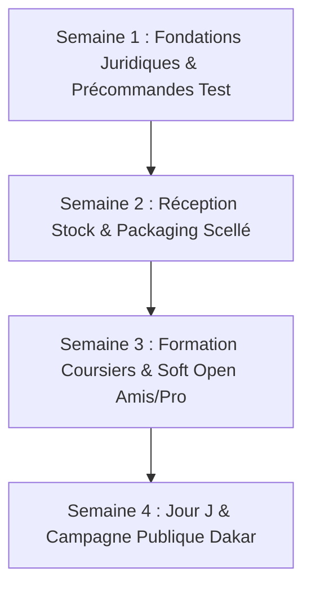

# Plan de Lancement Opérationnel (Launch Plan) : SenTechPLUS Dakar

*Organise le compte à rebours, le test préalable à faible coût, la feuille de route du Jour J et le suivi des 30 premiers jours.*

---

## 1. Test Préalable à Faible Coût (Avant d'engager le gros budget)

Avant d'engager l'achat du stock tampon complet (1 500 000 FCFA), nous exécutons un **test réel de précommande VIP sur Dakar** pour valider que le taux d'achat simulé par le panel (85%) se traduit par de vrais paiements.

* **Le Test :** Une page d'atterrissage privée + un groupe VIP WhatsApp « 50 Pionniers Tech Dakar » proposant le Pack Hero 65W à **15 900 FCFA** avec le câble 100W offert et la livraison gratuite en avant-première.
* **Le Critère de Validation (Success Line) :**
  * Objectif : Obtenir **25 précommandes fermes** (nom, numéro WhatsApp, quartier de Dakar et confirmation d'achat à la livraison) en 5 jours.
  * Si $\ge 20$ précommandes obtenues : Le marché est validé, feu vert pour le décaissement du stock fournisseur.
  * Si $< 15$ précommandes : Ajuster l'offre (ex: basculer l'accent sur le pack tremplin 20W à 9 900 FCFA).

---

## 2. Le Compte à Rebours vers le Jour J (Planning sur 4 Semaines)

### Semaine 1 : Fondations & Validation Pilote
* **Légal & Banque :** Validation du compte marchand Wave Business officiel au nom de SenTechPLUS.
* **Technique :** Vérification de l'ensemble des parcours d'achat sur `https://www.sentechplus.com` (panier, checkout, confirmation WhatsApp).
* **Test Terrain :** Lancement de la liste VIP (Objectif 25 inscrits qualifiés).

### Semaine 2 : Logistique, Fournisseurs & Packaging
* **Stock :** Commande et réception du lot initial de 60 blocs de charge GaN (33W et 65W) + 100 câbles nylon tressés 100W.
* **Packaging :** Réception des pochettes kraft renforcées et des 500 stickers holographiques scellés numérotés.
* **Stockage :** Mise en rayon et inventaire au local sécurisé de Sacré-Cœur.

### Semaine 3 : Équipe Coursiers & "Soft Open" (Rodage à blanc)
* **Recrutement Coursiers :** Briefing et contractualisation des 2 livreurs moto dédiés.
* **Formation SOP :** Entraînement au protocole d'inspection du blister devant le client et encaissement Wave via QR code.
* **Soft Open (48h) :** 15 livraisons tests réelles auprès d'amis, collègues et inscrits VIP pour chronométrer les temps de trajet réels (objectif moyen < 75 min).

### Semaine 4 : Lancement Public Officiel (Jour J)
* Activation des campagnes publicitaires TikTok & Instagram Ads.
* Envoi du message de lancement aux réseaux et communautés professionnelles dakaroises.

---

## 3. Feuille de Route du Jour J (Hour-by-Hour Run Sheet)

| Heure | Action / Étape | Responsable | Vérification / Plan de secours |
| :--- | :--- | :--- | :--- |
| **07h30** | Ouverture du local Sacré-Cœur, vérification des connexions 4G et terminaux. | Lead Ops | Routeur 4G de secours prêt avec puce Orange & Wave active. |
| **08h00** | Activation officielle des publicités sponsorisées TikTok et Instagram Ads (Hook 1 & Hook 2). | Marketing Lead | Vérifier que les liens pointent bien vers `https://www.sentechplus.com/checkout.php`. |
| **08h30** | Arrivée des 2 coursiers moto. Contrôle des sacoches étanches, fond de caisse (15 000 F en monnaie) et téléphones chargés à 100%. | Lead Ops | Motos avec réservoir plein. |
| **09h00** | Réception des premières commandes en direct sur le dashboard admin. | Dispatch | Appel WhatsApp de confirmation immédiate au client sous 3 minutes. |
| **10h30** | Départ de la première vague de coursiers (Tournées Plateau et Almadies). | Coursiers | Suivi en temps réel de la progression GPS. |
| **12h00** | Première publication "En direct des livraisons" sur Instagram Stories / TikTok (preuve sociale). | Marketing Lead | Partager la photo du premier client avec son colis scellé. |
| **14h30** | Deuxième vague de livraisons (commandes de la pause déjeuner). | Coursiers | |
| **18h30** | Retour des coursiers au local Sacré-Cœur. Rapprochement financier Wave & Espèces. | Lead Ops | Clôture des bons de livraison sur le serveur. |
| **20h00** | Bilan de la journée : Nombre de commandes, délai moyen constaté, avis clients recueillis. | Équipe complète | Ajustement immédiat pour le lendemain. |

---

## 4. Les 30 Premiers Jours : Pilotage & Seuils d'Alerte

### Objectif Financier (Le Point Mort du CFO)
* **Seuil de rentabilité mensuel :** 105 commandes / mois (soit **3.5 à 4 commandes par jour** à 15 900 FCFA).
* **Trajectoire planifiée pour le mois 1 :**
  * *Semaine 1 :* 2 à 3 commandes / jour (Phase de rodage).
  * *Semaine 2 :* 4 à 5 commandes / jour (**Seuil de rentabilité atteint**).
  * *Semaine 3 :* 6 à 8 commandes / jour (Dégagement de bénéfice net).
  * *Semaine 4 :* 8 à 10 commandes / jour (Plein régime de la flotte initiale).

### Points de Contrôle Hebdomadaires (Milestone Reviews)

* **Revue J+7 :**
  * *Question clé :* Le délai de livraison moyen est-il resté sous la barre des 90 minutes ?
  * *Action si alerte :* Si le délai dépasse 100 min, recentrer temporairement le périmètre express sur Dakar Centre (Plateau / Fann / Point E / Sacré-Cœur).
* **Revue J+14 :**
  * *Question clé :* Quel est le taux de conversion du site et le coût d'acquisition client (CAC) ?
  * *Seuil critique :* Si le CAC $> 4\,000 \text{ FCFA}$, couper les audiences larges et doubler la mise sur le parrainage direct par WhatsApp.
* **Revue J+30 :**
  * *Question clé :* Quel est le taux de recommandation et le taux de retour sous garantie 12 mois ?
  * *Validation d'échelle :* Si le taux de panne est $< 1\%$, commande du réassort de 200 unités et préparation de l'extension de gamme (écouteurs ANC et stations de charge sans fil).
